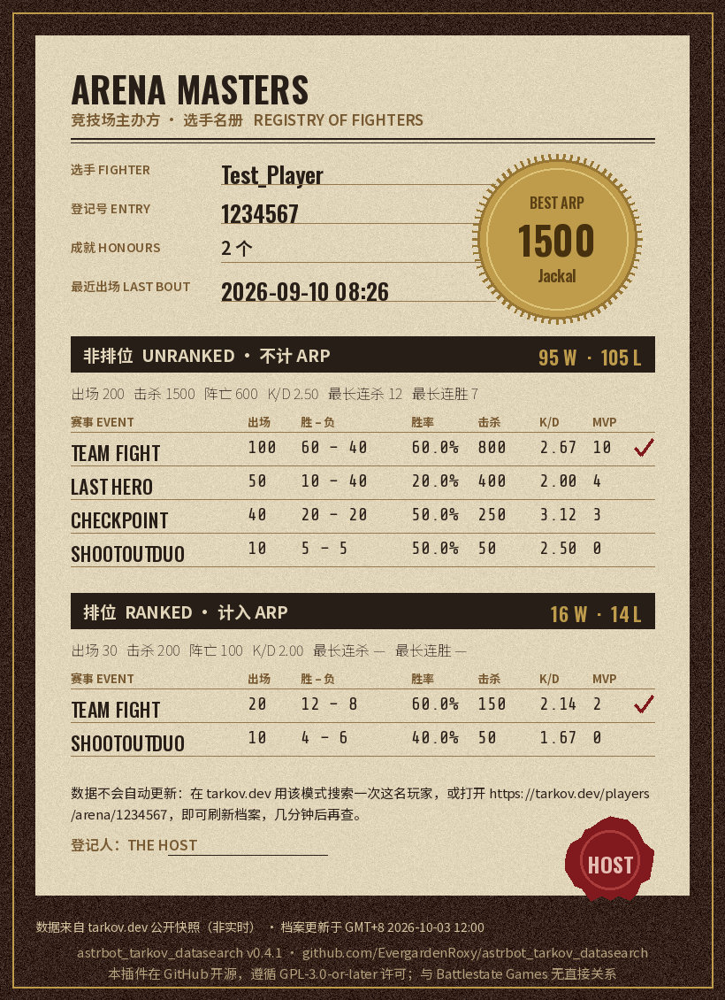
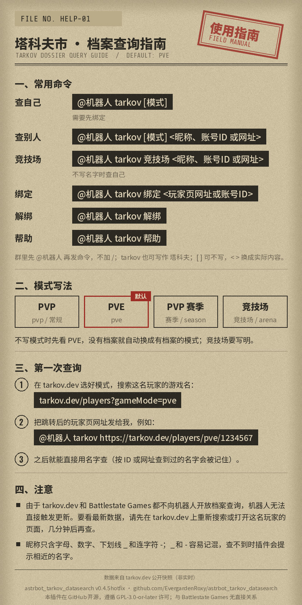

[](#ai-制作声明)

<a id="ai-制作声明"></a>

> [!IMPORTANT]
> **AI 制作声明：塔科夫数据查询采用生成式 AI 参与架构设计、编码、文档与测试。** AI 生成或修改的内容由项目维护者审阅、验证并承担最终维护责任。
>
> 参与的 AI：**Claude Opus 5.5**（通过 **Claude Code**）参与 0.1.0 至 0.4.4 版本的数据源调研与实测、方案制定、编码、测试、图片回复的设计与绘制、配置页说明，以及更新日志、核对清单（`checklist.md`）与交接文档（`handoff.md`）的编写。0.4.5 版本由 **Claude**（通过 **Claude Code**）接手开发，参与服务器状态、Boss 刷率、QQ 官方机器人命令入口的实现、测试与文档；Boss 图的背景纹理由维护者用 **GPT-Image-2.5-sunburst** 生成。

# 塔科夫数据查询

在 AstrBot 聊天中查询《逃离塔科夫》的数据：玩家档案，以及服务器状态和 Boss 刷率。数据全部来自 [tarkov.dev](https://tarkov.dev) 的公开内容。

## tarkov.dev 对机器人调用的限制与现状（玩家档案）

玩家档案来自 tarkov.dev 公开的快照，它没有向第三方机器人开放独立的调用方式，插件也不会尝试绕过限制：**只有在 tarkov.dev 上被搜索过的玩家才有档案，档案不会自动更新，第一次查某个玩家（包括你自己）之前要先到网站搜索他一次。** 详细说明和申请独立调用权限的途径见 [玩家数据查询](docs/player-query.md#tarkovdev-对机器人调用的限制与现状)。服务器状态和 Boss 刷率读取的是另一份公开的游戏数据，没有这些限制。

## 功能

- **[塔科夫玩家数据查询](docs/player-query.md)**：绑定自己的账号，用昵称、账号 ID 或玩家页网址查询自己或他人的档案——等级、阵营、PMC 与 Scav 的战局、存活率、K/D、技能；支持 PVP、PVE、PVP 赛季和塔科夫竞技场（段位、ARP、胜率）。
- **[服务器状态与 Boss 刷率](docs/status-and-boss.md)**（0.4.5 新增，默认关闭）：服务器各组件状态；各地图日常 Boss 与三狗的刷率全表，另显示活动 Boss；两者都可开启变化推送。
- **通用**：图片、文字、Markdown 三种回复方式（玩家查询）；所有人、仅管理员、管理员和指定用户三种权限，也可限定聊天；支持 QQ 官方机器人的 `@机器人 /命令` 写法。

## 安装与配置

需要 **AstrBot ≥ 4.16.0**。

1. 将插件安装到 AstrBot 的插件目录，或在插件管理页导入发行压缩包。
2. 在 AstrBot 的 Python 环境安装依赖：`pip install -r requirements.txt`（`aiohttp`、`yarl`、`pillow`，AstrBot 本身都已带）。
3. 按需修改默认模式、谁可以使用等设置，保存后生效。默认所有人都可以使用玩家查询；服务器状态和 Boss 刷率默认关闭，需要管理员在配置页打开。

## 开始使用

在群里先 @机器人，再发送命令，命令前面不加 `/`，例如 `@机器人 tarkov 帮助`（腾讯限制未经验证的 QQ 机器人只能这样被调用）。支持 `/` 唤醒的平台可以直接发 `/tarkov 帮助`，两种写法插件都能识别。

**查玩家档案**：第一次先在 tarkov.dev 搜索这名玩家，把跳转后的网址发给插件；之后可以绑定自己、用昵称或账号 ID 查询。

```text
@机器人 tarkov 绑定 https://tarkov.dev/players/regular/1234567   绑定自己的账号
@机器人 tarkov                                                   查自己
@机器人 tarkov pve Player_One                                    查别人（模式、昵称或账号 ID）
@机器人 tarkov 竞技场 7654321                                    查竞技场档案
@机器人 tarkov 帮助                                              显示用法
```

模式、绑定、昵称规则、竞技场段位等见 [塔科夫玩家数据查询](docs/player-query.md)。

**查服务器状态和 Boss 刷率**：管理员先在配置页打开“服务器状态图片查询”或“Boss 刷率功能总开关”。

```text
@机器人 tarkov status        服务器状态
@机器人 tarkov boss          各地图日常 Boss 与活动 Boss 的刷率全表
@机器人 tarkov boss 变化     最近一次刷率变化
```

变化推送、活动 Boss 规则、头像和设置见 [服务器状态与 Boss 刷率](docs/status-and-boss.md)。

## 回复方式

这一节说的是**玩家数据查询**的回复。在配置“输出方式”中选择，默认是图片：

- **图片**：情报档案风格，用自带的开源字体在本地绘制，不经过在线渲染服务；图片最下方写明插件名称、版本、仓库和开源许可，后面附一行玩家页链接。画图失败时自动改发文字。图上的元素都是插件自己画的，没有使用游戏素材；昵称里字体画不出的字符显示为 `?`。
- **文字**：纯文字，任何平台都能正常显示。
- **Markdown 文字**：带标题、表格和加粗，适合 Telegram、Discord 等；在 QQ 等平台上会显示出原始符号。

`@机器人 tarkov 帮助` 跟随这个设置：选“图片”时回复一张用法图片，否则回复文字版用法。找不到玩家、同名列表和出错提示，无论选哪种方式都以文字回复。






以上示例都是玩家数据查询的回复，数据均为虚构，由 `tools/build_preview.py` 生成。文字示例：

```text
【塔科夫 PVE 档案】Test_Player（账号 ID 1234567）
阵营 USEC｜等级 53
账号总游戏时长 1000 小时｜成就 30 个
最近活跃 2026-09-21 22:13

PMC：战局 1000，撤离 800，存活率 80.0%
　击杀 5000，死亡 100，K/D 50.00，击杀 PMC 900，PMC K/D 9.00
　匆匆逃离 30，转移 40，KIA 120，行动中失踪 10，最长连续存活 40 局
Scav：战局 50，撤离 30，存活率 60.0%
　击杀 100，死亡 10，K/D 10.00，击杀 PMC 20，PMC K/D 2.00
　匆匆逃离 5，KIA 15，最长连续存活 5 局
精英技能（4 项）：耐力、力量、代谢、专注
其他技能（前 10 项）：魅力 40、感知 35、搜索 30、手术 26、活力 25、投掷物 20、弹匣训练 18、健康 15、抗压 12、突击步枪 10

数据来自 tarkov.dev，档案更新于 2026-10-03 12:00（北京时间）
数据不会自动更新：在 tarkov.dev 用该模式搜索一次这名玩家，或打开 https://tarkov.dev/players/pve/1234567，即可刷新档案，几分钟后再查。
astrbot_tarkov_datasearch v0.4.5 · https://github.com/EvergardenRoxy/astrbot_tarkov_datasearch
本插件在 GitHub 开源，遵循 GPL-3.0-or-later 许可；与 Battlestate Games 无直接关系
```

服务器状态与 Boss 刷率目前只回复图片，不受“输出方式”影响，示例图见 [status-and-boss.md](docs/status-and-boss.md)。


## 通用设置

- **命令写法**：`@机器人 tarkov`（默认）、`/tarkov`，或 QQ 官方机器人提及后加斜杠的 `@机器人 /tarkov`，只影响显示。
- **QQ 官方机器人提及后斜杠命令兼容**：默认开启，让 `@机器人 /tarkov …`、`/status`、`/boss` 在 QQ 官方平台也能触发；关闭不影响框架本来能识别的命令。
- **启用简短查询命令**：`status`、`boss` 这样不带 `tarkov` 的短命令，与其他插件冲突时可以关闭，`tarkov status`、`tarkov boss` 仍可用。
- **谁可以使用**：所有人（默认）、仅管理员，或管理员和指定用户。“管理员”指 AstrBot 管理员，不是 QQ 群管理员。
- **指定用户 / 限定聊天**：填写平台用户 ID（例如 QQ 号）和 AstrBot 会话标识（聊天中发送 `/sid` 查看），留空不限制聊天。手工编辑配置文件时应为列表；写成其他类型时拒绝所有人。
- **访问 tarkov.dev 时使用代理 / 代理地址**：默认关闭。开启后所有请求都经过这个 HTTP/HTTPS 代理（不支持 SOCKS，需写明端口），不使用 AstrBot 或系统的代理设置；代理连不上时不会改为直连。部分服务器的 IP 会被 Cloudflare 拦截，查询提示“HTTP 403”时可以开启。

各功能自己的设置见对应的文档：[玩家数据查询的设置](docs/player-query.md#玩家功能的设置)、[状态与 Boss 的设置](docs/status-and-boss.md)。

## 数据存储

数据位于 `data/plugin_data/astrbot_tarkov_datasearch/`，具体文件见两份功能文档的“数据存储”一节：[玩家功能](docs/player-query.md#数据存储玩家功能)、[状态与 Boss](docs/status-and-boss.md#数据存储状态与-boss)。绑定只保存带密钥的哈希，不保存 QQ 号等原始 ID；插件不另存“谁查询了谁”，但 AstrBot 的日志会记下每条消息的发送者和内容，请像对待聊天记录一样保管日志和整个数据目录。

## 开源许可

本项目采用 **GNU General Public License v3.0 or later（GPL-3.0-or-later）**。完整许可见 [LICENSE](LICENSE)，数据来源与第三方声明见 [THIRD_PARTY.md](THIRD_PARTY.md)。

Boss 图的背景纹理是 AI 生成的图片（见 [THIRD_PARTY.md](THIRD_PARTY.md)）。图片使用的三款字体（思源黑体 Noto Sans SC 的裁剪版、Oswald、Share Tech Mono）采用 SIL Open Font License 1.1，许可文本与字体一起放在 `tarkov_core/fonts/`。文档里的 Boss 示例图含有 Boss 头像，是 Battlestate Games 的游戏美术，不适用本项目的许可，也不包含在插件包里。

本插件与 Battlestate Games 和 tarkov.dev 没有关联。

## 文档

- [塔科夫玩家数据查询](docs/player-query.md)：命令、模式、绑定、竞技场、数字含义、设置和数据存储。
- [服务器状态与 Boss 刷率](docs/status-and-boss.md)：命令、设置、读图方法、活动 Boss 规则、变化推送和数据存储。
- [CHANGELOG.md](CHANGELOG.md)：每个版本给使用者带来了哪些变化。
- [checklist.md](checklist.md)：用通俗的话说明做了什么、为什么、怎么核对。
- [handoff.md](handoff.md)：给 AI 和工程师看的英文技术记录，写明每次修改的代码位置、依据和测试。
