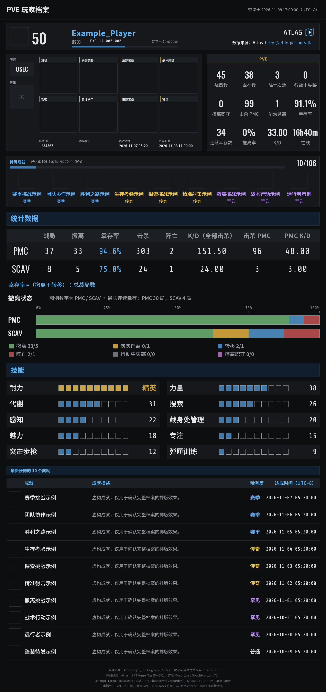
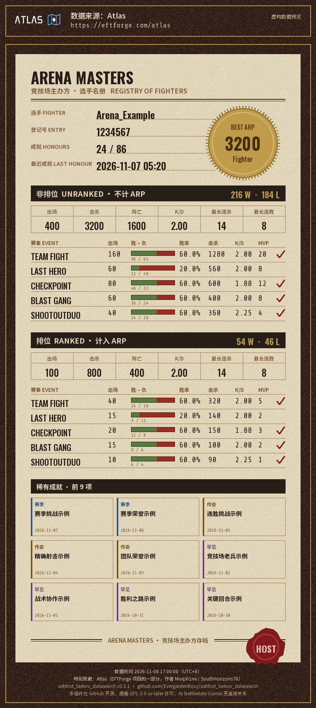
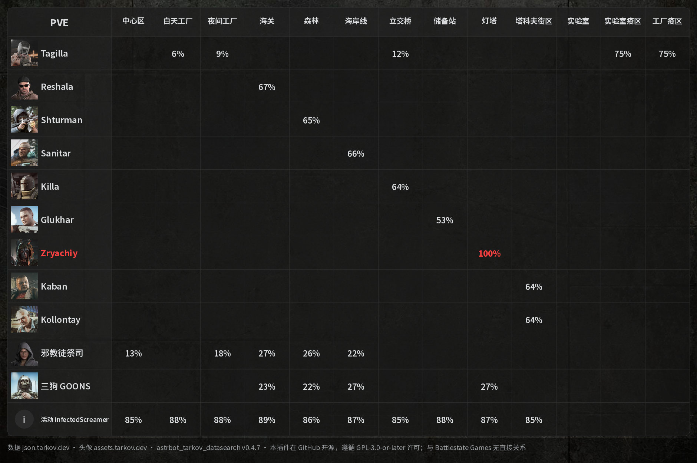
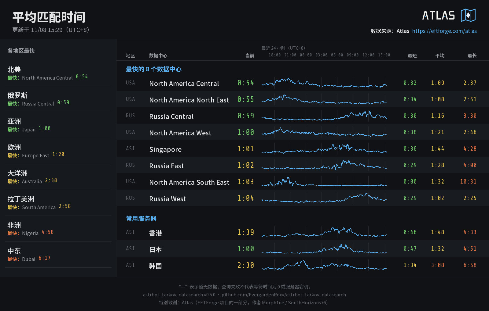
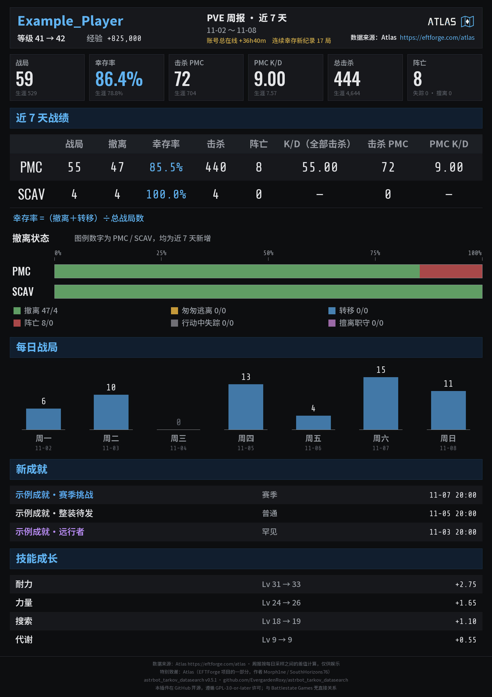
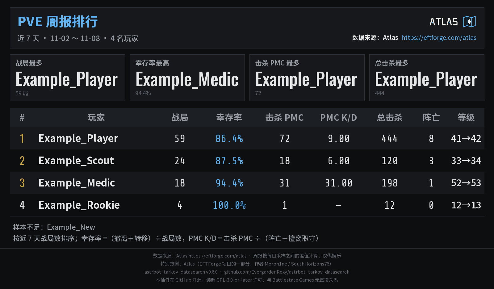

<a id="ai-制作声明"></a>

[](#ai-制作声明)

Fable 5.2 进行了 v0.7.0 的整体重构，旧版本由 Opus 5.5 构建。

# 塔科夫数据查询

在 AstrBot 聊天中查询《逃离塔科夫》的数据：玩家档案、服务器状态、Boss 刷率、各服务器的平均匹配时间，以及指定玩家的“近 7 天”周报。

## 功能

- **[玩家档案](docs/player-query.md)**：绑定自己的账号，用昵称、账号 ID 或玩家页网址查询自己或他人——等级、阵营、PMC 与 Scav 的战局、幸存率、K/D、技能、装备和成就。支持 PVP、PVE、PVP 赛季和竞技场（段位、ARP、胜率）。
- **[服务器状态](docs/status-and-boss.md)**：游戏各服务组件当前是否正常；状态变化时可以推送到群里。
- **[Boss 刷率](docs/status-and-boss.md)**：各地图 Boss 与三狗的刷率全表，包括活动 Boss；刷率变化时可以推送到群里。
- **[匹配时间](docs/matching.md)**：各数据中心的平均匹配等待时间和最近 24 小时走势，列出各地区最快的服务器，以及香港、日本、韩国三个常用服务器。
- **[玩家周报](docs/weekly-report.md)**：每个群维护自己的玩家名单，插件每天采样一次，生成“近 7 天”的个人周报和群内排行；可以每周定时把排行发到群里。

所有查询结果都是本地绘制的图片。支持 QQ 官方机器人。

## 示例

| 玩家档案 | 竞技场 |
| --- | --- |
|  |  |

| Boss 刷率 | 匹配时间 |
| --- | --- |
|  |  |

| 个人周报 | 周报排行 |
| --- | --- |
|  |  |

玩家、竞技场和周报示例使用虚构数据。更多示例：[帮助](docs/help_preview.jpg)、[服务器状态](docs/status_preview.jpg)、[Boss 变化推送](docs/boss_changes_preview.jpg)、[tarkov.dev 快照档案](docs/preview.jpg)。

## 命令

```text
@机器人 tarkov 帮助                      查看全部用法
@机器人 tarkov 绑定 <昵称或账号ID>        绑定自己的账号
@机器人 tarkov                           查自己
@机器人 tarkov pve <昵称或账号ID>         查别人（pvp、pve、赛季、竞技场）
@机器人 tarkov status                    服务器状态
@机器人 tarkov boss                      Boss 刷率
@机器人 tarkov 匹配                       匹配时间
@机器人 tarkov 周报                       玩家周报
```

也可以写成 `/tarkov …`。QQ 官方机器人另有不含空格的单词命令：`tpve`、`tbind`、`tstatus`、`tboss`、`tmatch`、`tweekly` 等。

## 安装

需要 AstrBot 4.16.0 或更高版本。

1. 在 AstrBot 插件管理页安装本插件，或导入发行压缩包。
2. 在 AstrBot 的 Python 环境安装依赖：`pip install -r requirements.txt`。
3. 在插件配置页打开需要的功能，保存后生效。

## 文档

- [玩家档案查询](docs/player-query.md)
- [服务器状态与 Boss 刷率](docs/status-and-boss.md)
- [服务器匹配时间](docs/matching.md)
- [玩家周报](docs/weekly-report.md)
- [通用设置与数据存储](docs/settings.md)
- [开发指南](docs/development.md)
- [更新日志](CHANGELOG.md)

## 数据来源与致谢

玩家档案、匹配时间和玩家周报来自 **[Atlas](https://eftforge.com/atlas)**（[EFTForge](https://github.com/SouthHorizons76/EFTForge) 项目的一部分，作者 Morph1ne / SouthHorizons76），特别感谢。服务器状态和 Boss 刷率来自 [tarkov.dev](https://tarkov.dev)。

本插件与 Battlestate Games、tarkov.dev 和 Atlas 没有关联。

## 开源许可

本项目采用 **GNU General Public License v3.0 or later（GPL-3.0-or-later）**，完整许可见 [LICENSE](LICENSE)；字体、图片素材和数据来源的声明见 [THIRD_PARTY.md](THIRD_PARTY.md)。
