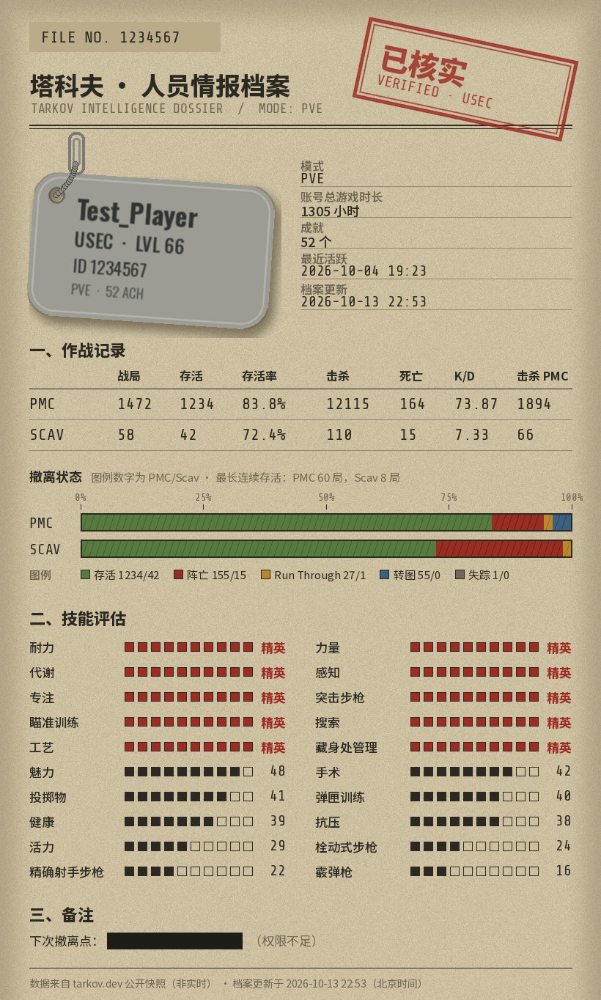

[](#ai-制作声明)

<a id="ai-制作声明"></a>

> [!IMPORTANT]
> **AI 制作声明：塔科夫玩家数据查询采用生成式 AI 参与架构设计、编码、文档与测试。** AI 生成或修改的内容由项目维护者审阅、验证并承担最终维护责任。
>
> 参与的 AI：**Claude Opus 5.5**（通过 **Claude Code**）参与 0.1.0 至 0.3.0 版本的数据源调研与实测、方案制定、编码、测试、图片回复的设计与绘制、配置页说明，以及更新日志、核对清单（`checklist.md`）与交接文档（`handoff.md`）的编写。

# 记录文档

仓库里三份记录文档的分工：

- **CHANGELOG.md**：每个版本给使用者带来了哪些变化。
- **checklist.md**：用通俗的话说明做了什么、为什么、怎么核对。
- **handoff.md**：给 AI 和工程师看的英文技术记录，写明每一次修改的代码位置、依据和测试，用于排查问题和代码审查。

# 塔科夫玩家数据查询

在 AstrBot 聊天中绑定自己的《逃离塔科夫》账号，查询自己或其他玩家的档案：等级、阵营、PMC 与 Scav 的战局数、存活率、K/D 和技能等级。支持 PVP、PVE 和 PVP 赛季三种模式，可以用昵称、账号 ID 或 tarkov.dev 玩家页网址查询。

数据来自 [tarkov.dev](https://tarkov.dev) 公开的玩家档案快照（`players.tarkov.dev`）。插件不登录任何游戏账号，也不需要任何凭证。

## 功能

- 绑定自己的账号后，发送 `/tarkov` 就能查自己。
- 查别人：可以用 tarkov.dev 玩家页网址、账号 ID 或昵称。按 ID 或网址查到过一次的玩家，插件会记住他的名字，之后所有人都能直接用名字查到。
- 可以指定模式，不写时使用配置里的默认模式。
- 显示内容：
  - 阵营、等级、声望、账号总游戏时长、成就数、最近活跃时间；
  - PMC 与 Scav 的战局数、撤离数、存活率、击杀、死亡、K/D、击杀 PMC 数、撤离状态（撤离 / 匆匆逃离 / 转移 / KIA / 行动中失踪）和最长连续存活；
  - 精英技能和等级最高的若干项技能。
- 每次回复都提醒“数据不会自动更新”，并附上这名玩家的 tarkov.dev 页面链接；还会显示档案的更新时间，超过 30 天没有更新时会注明；按旧名字查到改过名的玩家时会注明现在的昵称。
- 三种回复方式，在配置中选择：
  - **图片**（默认）：情报档案风格的图片，在本地绘制；
  - **文字**：纯文字；
  - **Markdown 文字**：适合能显示 Markdown 的平台。
- 支持所有人、仅管理员、管理员和指定用户三种调用权限，也可以只允许在指定的聊天中使用。

## 安装与配置

需要 **AstrBot ≥ 4.16.0**。

1. 将本插件安装到 AstrBot 的插件目录，或使用插件管理页导入发行压缩包。
2. 在 AstrBot 使用的 Python 环境安装依赖：`pip install -r requirements.txt`（`aiohttp`、`yarl` 和 `pillow`，AstrBot 本身都已带）。
3. 按需修改默认模式、谁可以使用等设置，保存后生效。默认所有人都可以使用。

## 开始使用
第一次查某个玩家（包括你自己）之前，需要先在 tarkov.dev 网站上搜索他一次，原因见下方“数据从哪里来，有什么限制”。

1. 打开 tarkov.dev 的玩家搜索页（`https://tarkov.dev/players`，页面上可以切换 PVP / PVE / 赛季，请选这名玩家玩的模式），输入游戏名搜索。网页会跳转到这名玩家的页面，网址形如 `https://tarkov.dev/players/regular/1234567`（`regular` 是 PVP，另有 `pve`、`pvp-season`）。每个模式的档案要在那个模式下搜索一次才会生成。
2. 把这个网址发给插件：

```text
/tarkov 绑定 https://tarkov.dev/players/regular/1234567   （绑定为自己的账号，任一模式的网址都可以）
/tarkov                                                 （查自己：先看默认模式，没有档案就换成有档案的模式）
/tarkov pve                                             （查自己的 PVE 档案）
/tarkov 赛季                                             （查自己的 PVP 赛季档案）
/tarkov https://tarkov.dev/players/pvp-season/7654321   （查别人，用网址，模式取自网址）
/tarkov 7654321                                        （查别人，用账号 ID，不写模式）
/tarkov pvp Player_One                                    （查别人，用昵称：插件已经记住这个名字时）
/tarkov 解绑                                             （解除自己的绑定）
/tarkov 帮助                                             （显示用法）
/塔科夫 pve Player_One                                     （/塔科夫 与 /tarkov 相同）
```

**三种模式都支持**，同一个账号在 PVP、PVE、PVP 赛季下的档案是分开的，插件每次会同时查看三个模式：

- **不写模式**：先看默认模式（配置“默认模式”，默认 PVP）；这个模式没有档案时，自动显示有档案的模式，并注明“PVP 模式下没有这个账号的档案，下面是 PVE 模式的档案”。
- **写了模式，或用网址查询**：只显示这个模式；这个模式没有档案时，说明哪些模式有，并给出对应的命令。
- **每次回复**都会注明这个账号在哪些其他模式下也有档案。
- **绑定**的是账号本身，与模式无关：任一模式下有档案就能绑定。
- 名字与账号 ID 的对应关系也与模式无关：在任一模式下查到过，所有模式都能按名字查。

- **模式**：`pvp`（也可写 `regular`、`常规`、`普通`）、`pve`、`赛季`（也可写 `season`、`pvp-season`），不区分大小写。用网址查询时，模式取自网址；网址的模式和写的模式不一致时会提示。插件不支持竞技场（arena）模式。
- **绑定**：可以发网址、账号 ID，或插件已记住的昵称；绑定前插件会先读一次档案确认存在。同一个平台账号（例如同一个 QQ 号）在所有群和私聊里共用一个绑定。命令写作 `绑定`/`bind`、`解绑`/`unbind`。
- **昵称**：字母、数字、下划线和连字符，3～24 个字符，不区分大小写。插件只认得“被绑定过，或按 ID/网址查到过”的名字（所有人共享）；查不到时会回复上面的操作步骤。玩家名字恰好是 `help`、`pvp`、`pve`、`season` 等命令词时，要写上模式，例如 `/tarkov pvp season`。
- **账号 ID**：纯数字。如果某个 ID 没有档案，而这串数字也符合昵称规则，插件会再按昵称查一次。

## 回复方式

在配置“输出方式”中选择，默认是图片：

- **图片**：情报档案风格的图片，用插件自带的开源字体在本地绘制，不经过任何在线渲染服务。图片后面附一行这名玩家的 tarkov.dev 页面链接，方便刷新数据。生成一张约 0.2～0.3 秒，JPEG 约 300～400 KB。画图失败时自动改发文字，并在末尾注明。
  - 图上的塔科夫元素都是插件自己画的（狗牌、撤离状态条、档案纸张），没有使用游戏素材或标志。
  - 昵称里有字体画不出的字符时显示为 `?`。
- **文字**：纯文字，任何平台都能正常显示。
- **Markdown 文字**：带标题、表格和加粗。适合能显示 Markdown 的平台（如 Telegram、Discord）；在 QQ 等平台上会显示出原始符号。

找不到玩家、同名列表和出错提示，无论选哪种方式都以文字回复。

图片示例（玩家名和账号 ID 为虚构）：



文字示例（玩家名和账号 ID 为虚构）：

```text
【塔科夫 PVE 档案】Test_Player（账号 ID 1234567）
阵营 USEC｜等级 53
账号总游戏时长 1000 小时｜成就 30 个
最近活跃 2026-09-28 20:53

PMC：战局 1000，撤离 800，存活率 80.0%
　击杀 5000，死亡 100，K/D 50.00，击杀 PMC 900
　匆匆逃离 30，转移 40，KIA 120，行动中失踪 10，最长连续存活 40 局
Scav：战局 50，撤离 30，存活率 60.0%
　击杀 100，死亡 10，K/D 10.00，击杀 PMC 20
　匆匆逃离 5，KIA 15，最长连续存活 5 局
精英技能（4 项）：耐力、力量、代谢、专注
其他技能（前 10 项）：魅力 40、感知 35、搜索 30、手术 26、活力 25、投掷物 20、弹匣训练 18、健康 15、抗压 12、突击步枪 10

数据来自 tarkov.dev，档案更新于 2026-10-03 12:00（北京时间）
数据不会自动更新：在 tarkov.dev 用该模式搜索一次这名玩家，或打开 https://tarkov.dev/players/pve/1234567，即可刷新档案，几分钟后再查。
```

数字的含义：

- **K/D** = 击杀 ÷ 死亡。这里的击杀包括 AI，与游戏内统计页相同。PVE 模式下的“击杀 PMC”是 AI PMC。
- **撤离状态**沿用游戏里的叫法：撤离、匆匆逃离、转移、KIA、行动中失踪。
- **存活率** = 撤离 ÷ 战局数。
- **账号总游戏时长**不是单个模式的时长：一份真实的赛季档案只有 90 局，显示的却是 7141 小时。
- **等级**由总经验按 tarkov.dev 的等级经验表换算。
- **技能等级**是进度除以 100，满 51 级为精英。

## 数据从哪里来，有什么限制
插件只访问 `https://players.tarkov.dev`，这是 tarkov.dev 存放玩家档案快照的地方（`{模式}/{账号ID}.json`）。实测确认了下面几点：

- **只有在 tarkov.dev 网站上被搜索过的玩家才有档案，和玩了多久无关。** 例如两名老玩家此前在三个模式下都查不到档案；在网站上用 PVE 模式搜索一次后，他们的 PVE 档案当场生成，其他模式仍然没有。所以第一次查某个玩家前，需要先在网站上搜索一次。
- **档案不会自动更新。** 档案是“上次有人在网站上搜索或查看这名玩家时”的快照，插件无法让 tarkov.dev 刷新它。想看最新数据，请先在网站上重新搜索或打开这名玩家的页面，几分钟后再查。回复里会附上这个页面的链接，并写明档案的更新时间。
- **刚搜索完可能要等几分钟。** tarkov.dev 前面的 Cloudflare 会缓存查询结果，“没有档案”的结果也会缓存几分钟；插件自己也会把档案在内存里缓存一段时间（默认 10 分钟，“没有档案”的结果只缓存 1 分钟）。回复用的是缓存里超过 1 分钟的档案时，会注明是几分钟前取得的；刚在网站上刷新过的话，发送这名玩家的页面网址查询，插件会跳过缓存直接取最新的档案。
- **网站的实时查询需要人机验证，机器人用不了。** 网站按名字实时查询玩家，靠的是 `player.tarkov.dev` 接口。这个接口要求浏览器先在后台完成 Cloudflare 人机验证；一般浏览器感觉不到，但没有验证的请求会被拒绝。插件不使用这个接口，也不会尝试绕过人机验证或访问频率限制，所以做不到“没被搜索过的玩家也能直接按名字查到”。
- **名字和 ID 的对应关系主要靠用户提供。** tarkov.dev 也发布每天重建的昵称名单，但只收录在网站上被搜索过的玩家，而且新搜索的玩家第二天才会出现。所以插件默认不下载它，而是记住用户绑定或查询过的名字；管理员可以在配置里打开名单作为补充。
- **部分服务器的 IP 会被 Cloudflare 拦截。** 查询时会提示“HTTP 403，Cloudflare 拦截”，可以在配置中开启代理。

## 常用设置

- **默认模式**：命令里没写模式时使用，默认 PVP。
- **输出方式**：图片（默认）、文字或 Markdown 文字，见上方“回复方式”。
- **谁可以使用**：所有人（默认）、仅管理员，或管理员和指定用户。“管理员”指 AstrBot 管理员，不是 QQ 群管理员。
- **指定用户**：填写平台用户 ID（例如 QQ 号），只在“管理员和指定用户”模式下生效。
- **限定聊天**：只允许在这些聊天中使用，留空不限制。填写 AstrBot 会话标识（在聊天中发送 `/sid` 查看），必须与会话标识完全相同（首尾空格和空行会被忽略）。手工编辑配置文件时，这一项和“指定用户”应是列表；写成一个字符串时按一项处理，写成其他类型时拒绝所有人。
- **显示的技能数**：精英技能总是全部列出，这里设置其余技能显示几项，默认 10，设为 0 不显示技能。
- **档案缓存时间**：同一个玩家在这段时间内再次查询时不再访问 tarkov.dev，默认 10 分钟，只保存在内存中。用玩家页网址查询和绑定时不使用缓存。多人同时查同一名玩家时只请求一次；所有人合计最多同时进行 6 个档案请求。
- **同时使用 tarkov.dev 的昵称名单**：默认关闭。开启后，插件记录里找不到的名字会再查 tarkov.dev 的昵称名单。名单只收录在网站上被搜索过的玩家，PVP 名单约 30 MB，本地约占 100 MB。
- **昵称名单更新间隔**：只在开启上一项时使用，默认 168 小时（每周一次）。tarkov.dev 每天重建名单，所以每次检查通常都要重新下载（PVP 约 30 MB，加上约 25 秒整理）；下载失败后 10 分钟内不会再试。
- **下载最长等待**：下载名单最多等多久，默认 120 秒。查询单个档案最多等这个时间和 60 秒中较小的一个（不开名单时也生效），所以设得低于 60 秒会缩短档案查询的等待。
- **访问 tarkov.dev 时使用代理 / 代理地址**：默认关闭。开启后插件的所有请求都经过这个 HTTP/HTTPS 代理（不支持 SOCKS），不使用 AstrBot 或系统的代理设置；代理连不上时不会改为直连，开启后没有填写地址时查询会报错。代理地址必须写明端口。

## 数据存储
数据位于 `data/plugin_data/astrbot_tarkov_datasearch/`：

- `accounts.sqlite3`：
  - 绑定关系：平台和用户 ID 的带密钥哈希（HMAC-SHA256）→ 账号 ID 和昵称，不保存 QQ 号等原始 ID；`/tarkov 解绑` 会删除自己的绑定。密钥是第一次运行时随机生成的 `binding.key`（只有运行 AstrBot 的用户能读），只拿到数据库无法还原 QQ 号；但同时拿到密钥的人仍可以逐个尝试 QQ 号，请像对待聊天记录一样保管整个数据目录。删除 `binding.key` 会让所有绑定失效。
  - 所有人共享的“名字 → 账号 ID”记录：每次绑定、每次查到档案时更新，最多保留 20 万条，超出时删除最久没见过的。这些名字本来就在 tarkov.dev 公开。
- `names-profile.sqlite3`、`names-pve.sqlite3`、`names-pvp-season.sqlite3`：只在开启“同时使用 tarkov.dev 的昵称名单”后，第一次按昵称查询对应模式时生成。PVP 名单约 100 MB，PVE 约 4 MB，赛季约 1.5 MB。可以随时删除，关闭该选项后也可以删除。
- 玩家档案只缓存在内存中，不写入磁盘。图片在内存中生成后直接发送，不保存文件。
- 插件自己不另存“谁查询了谁”的记录；但 AstrBot 的日志会记下每条消息的发送者和内容（包括 `/tarkov` 命令），插件日志里也有被查询的昵称或 ID，请像对待聊天记录一样保管日志。

## 开源许可

本项目采用 **GNU General Public License v3.0 or later（GPL-3.0-or-later）**。完整许可见 [LICENSE](LICENSE)，数据来源与第三方声明见 [THIRD_PARTY.md](THIRD_PARTY.md)。

图片使用的三款字体（思源黑体 Noto Sans SC 的裁剪版、Oswald、Share Tech Mono）采用 SIL Open Font License 1.1，许可文本与字体一起放在 `tarkov_core/fonts/`。

本插件与 Battlestate Games 和 tarkov.dev 没有关联。
