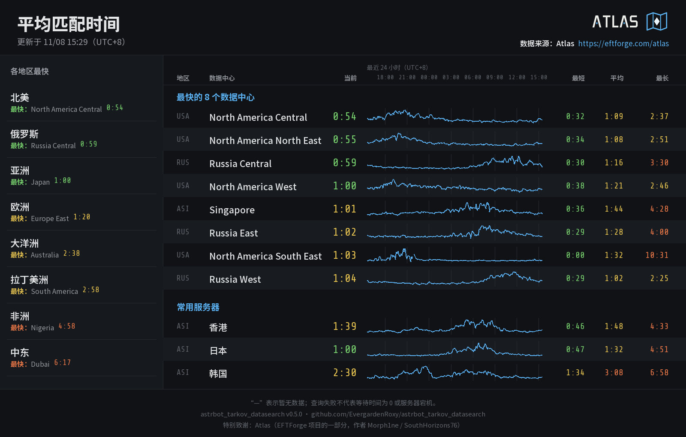

[← 返回 README](../README.md)

# 服务器匹配时间

查看《逃离塔科夫》各数据中心的平均匹配等待时间和最近 24 小时的走势。数据来自 [Atlas](https://eftforge.com/atlas)，是按数据中心统计的公开数据，不含玩家信息。

```text
@机器人 tarkov 匹配        （也可写 tarkov matching；QQ 官方机器人单词命令 tmatch）
```

命令不带参数。回复一张图片，后面附一行可点击的 Atlas 链接；查询失败时回复一行文字。



## 读图

- **左上角**：“更新于”是 Atlas 最近一次采样的时间（北京时间）。显示的是旧数据时，后面有橙色提示。
- **各地区最快**：俄罗斯、欧洲、北美、亚洲、大洋洲、拉丁美洲、中东、非洲，各列出当前等待最短的数据中心。
- **最快的 8 个数据中心**：从快到慢排列，不含下面的常用服务器。
- **常用服务器**：固定显示香港、日本、韩国。
- **每一行**：当前等待时间、24 小时折线，以及 24 小时内的最短、平均、最长。
- 时间写成“分:秒”。绿色不超过 1 分钟，黄色不超过 3 分钟，橙色更长。
- `—` 表示 Atlas 没有提供这个值。折线在没有数据的时段断开；每一行按自己的范围缩放，行与行之间的高低不能直接比较。
- 查询失败不代表等待时间为 0，也不代表服务器宕机。

## 更新频率

Atlas 是个人维护的服务，插件不做后台轮询：

- 所有用户和群聊共用一份结果，15 分钟内的查询都直接使用它。
- 15 分钟后由下一次查询触发更新；多人同时查询只发一次请求。
- 更新失败时，60 分钟内的旧结果继续显示并在图上注明；没有可用结果才回复查询失败，15 分钟内不再重试。
- Atlas 拒绝访问（401/403）时，30 分钟内不再请求，也不显示旧数据；到时自动恢复。
- Atlas 要求等待（429）时，按它给出的时间暂停。
- 结果只保存在内存里，重启后清空。

## 设置

配置页“Atlas 查询与限额”一组：

- **启用服务器匹配时间查询**：关闭后命令回复“尚未开启”，不访问 Atlas。
- **Atlas 共用请求间隔**（10～300 秒）：与玩家查询共用。

代理设置见 [通用设置](settings.md)。Atlas 标志的来源见 [THIRD_PARTY.md](../THIRD_PARTY.md)。
