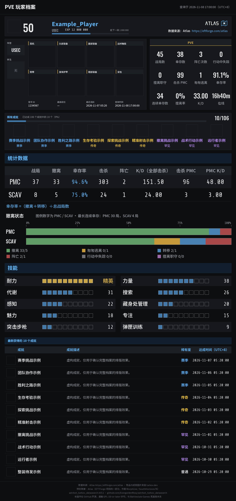

[← 返回 README](../README.md)

# 玩家档案查询

绑定自己的《逃离塔科夫》账号，查询自己或其他玩家的档案。支持 PVP、PVE、PVP 赛季和竞技场，每次查询一个模式。



示例使用虚构数据，图标为占位。竞技场示例见 [选手名册](arena_legacy_atlas_reference_v2.jpg)。

## 命令

```text
@机器人 tarkov 绑定 <昵称、账号ID 或网址>     绑定为自己的账号（也可写 bind）
@机器人 tarkov 解绑                          解除绑定（也可写 unbind）
@机器人 tarkov                               查自己，使用默认模式
@机器人 tarkov pve                           查自己的 PVE 档案
@机器人 tarkov pvp Player_One                按昵称查别人
@机器人 tarkov 7654321                       按账号 ID 查别人
@机器人 tarkov 竞技场 Player_One             查竞技场
@机器人 tarkov pve Player_One 刷新           跳过缓存重新查询
@机器人 tarkov 帮助                          显示用法
```

- `塔科夫` 与 `tarkov` 相同；也可以写成 `/tarkov …`。
- **模式**：`pvp`（或 `regular`、`常规`、`普通`）、`pve`、`赛季`（或 `season`、`pvp-season`）、`竞技场`（或 `arena`），不区分大小写。不写模式时使用配置的默认模式。
- **目标**：昵称、账号 ID（纯数字），或 tarkov.dev 玩家页网址。昵称恰好是 `help`、`pvp` 这类命令词时，请写上模式。
- **绑定**：同一个平台账号在所有群和私聊里共用一个绑定；绑定的是账号本身，与模式无关。
- **QQ 官方机器人单词命令**：`tpvp`、`tpve`、`tseason`、`tarena`（后面写昵称、账号 ID 或网址，不写就查自己）、`tbind`、`tunbind`、`thelp`。

## 档案里有什么

- **PVP／PVE／赛季**：阵营、等级、声望、账号总游戏时长、成就；PMC 与 Scav 的战局、幸存率、击杀、K/D 和撤离状态条；16 项技能（精英优先）；装备；稀有成就和最新成就。
- **竞技场**：非排位和排位的汇总、各模式战绩、段位、最佳 ARP、成就完成数，以及最多 9 项成就（按稀有度和获得时间排序）。接口没有提供的分区不显示。
- 成就名称和描述使用 Atlas 提供的中文，没有中文时显示英文。
- 图片带 Atlas 标志、来源链接和数据时间；图片后附一行可点击的链接。

### 数字的含义

- **幸存率** =（撤离＋转移）÷战局数。
- **K/D** = 击杀 PMC ÷（阵亡＋擅离职守）；统计表里的“K/D（全部击杀）”用全部击杀数。PVE 模式下的“击杀 PMC”是 AI PMC。
- **账号总游戏时长**是整个账号的时长，不分模式。
- **技能等级**是进度除以 100，满 51 级为精英。
- 竞技场的“最近成就”是最新一项成就的时间，不是最近对局时间；“最佳 ARP”是历史最高值。

### 竞技场段位

按最佳 ARP 对照：

| 段位 | 名称 | ARP |
|---|---|---|
| D | Marauder | ≤1000 |
| D+ | Jackal | 1001–2000 |
| C | Mercenary | 2001–3000 |
| C+ | Fighter | 3001–4000 |
| B | Warrior | 4001–5000 |
| B+ | Gladiator | 5001–6000 |
| A | Veteran | 6001–7000 |
| A+ | Professional | 7001–7900 |
| S 及以上 | 竞技场前100名玩家 | 7900 以上 |

S 以上按排行榜名次划分，档案里查不到名次，统一显示为“竞技场前100名玩家”。

## 查询次数与限流

数据来自 [Atlas](https://eftforge.com/atlas)，这是个人维护的服务，插件会控制请求量：

- **每人**每小时可联网查询 10 次，其中刷新最多 3 次；两次查询至少间隔 30 秒，两次刷新至少间隔 5 分钟。命中缓存不计次数。
- **所有用户共用**：相邻两次 Atlas 请求至少间隔 10 秒；每分钟最多 15 次、每小时最多 200 次玩家请求。额度用完时回复还要等多久，缓存里的档案仍可查看。
- 查过的档案在内存里缓存 10 分钟；命令末尾加“刷新”跳过缓存。
- 按昵称查询需要先搜索、再取档案，共两个请求，会多等一个间隔。

### 出错时

- **Atlas 请求失败**（网络、超时、限流、服务端错误）：改用 tarkov.dev 的快照，并在回复里注明。Atlas 明确回答“没有这个账号”或“这个模式没有档案”时不会改用快照。
- **Atlas 拒绝访问（401/403）**：30 分钟内不再向它发送玩家请求，到时自动恢复；期间改用快照。
- **改名**：档案昵称与所写昵称不一致时，插件会再做一次实时搜索确认。确认不了时，绑定会被拒绝（请改用账号 ID），普通查询会注明是按已有账号 ID 显示的。

## tarkov.dev 快照

在设置里把“玩家数据来源”改为 tarkov.dev，或 Atlas 请求失败时，插件读取 [tarkov.dev](https://tarkov.dev) 公开的玩家档案快照。它有三个限制：

- **只有在 tarkov.dev 网站上被搜索过的玩家才有档案。**
- **档案不会自动更新**，是上次有人在网站上搜索这名玩家时的快照。
- 所以第一次查某个玩家之前，要先到 `https://tarkov.dev/players` 用对应模式搜索他一次，几分钟后再查；想刷新数据时也一样。

使用快照来源时：

- 不写模式的查询先看默认模式，没有档案时自动显示有档案的模式；回复里注明这个账号在哪些其他模式也有档案。
- 可以直接发玩家页网址（如 `https://tarkov.dev/players/regular/1234567`）查询或绑定，模式取自网址。
- 插件会记住绑定过、查到过的名字，之后所有人都能直接用名字查；另可使用 tarkov.dev 的昵称名单（见下方设置）。
- 回复附玩家页链接和档案更新时间，超过 30 天没有更新会注明。

插件不会绕过 tarkov.dev 对机器人的限制。

## 设置

配置页“玩家数据查询”和“Atlas 查询与限额”两组；命令写法、权限、代理见 [通用设置](settings.md)。

- **玩家数据来源**：Atlas（默认）或 tarkov.dev 快照。
- **默认模式**：命令里没写模式时使用，默认 PVE。
- **不写模式时也查竞技场**：只对快照来源有效。
- **显示的技能数**：快照档案里除精英技能外显示几项。
- **档案缓存时间**：默认 10 分钟。
- **同时使用 tarkov.dev 的昵称名单**：快照来源按昵称查询时使用。首次按昵称查 PVP 会下载约 30 MB，本地约占 100 MB；不需要可以关闭。另有“昵称名单更新间隔”和“下载最长等待”。
- **Atlas 共用请求间隔**（10～300 秒）、**每分钟／每小时请求上限**（最多 15／200）、**每人两次查询／刷新的最短间隔**：只能调得更严，不能放宽。
- **拉取常用图标 / 清除图标缓存**：一次性动作，执行后自动关闭。装备和成就图标平时按需取得，没有图标时用占位框。
- **完整中文字体下载地址**：默认地址下载失败时填写镜像。

## 数据存储（玩家功能）

位于 `data/plugin_data/astrbot_tarkov_datasearch/`：

- `accounts.sqlite3`：
  - 绑定关系：平台和用户 ID 的带密钥哈希 → 账号 ID 和昵称，不保存 QQ 号等原始 ID。密钥是首次运行时生成的 `binding.key`，删除它会让所有绑定失效。
  - 所有人共享的“名字 → 账号 ID”记录，最多 20 万条。
- `names-*.sqlite3`：tarkov.dev 昵称名单，用到时才生成，可以随时删除。
- 玩家档案只缓存在内存里，图片生成后直接发送，都不写入磁盘。
