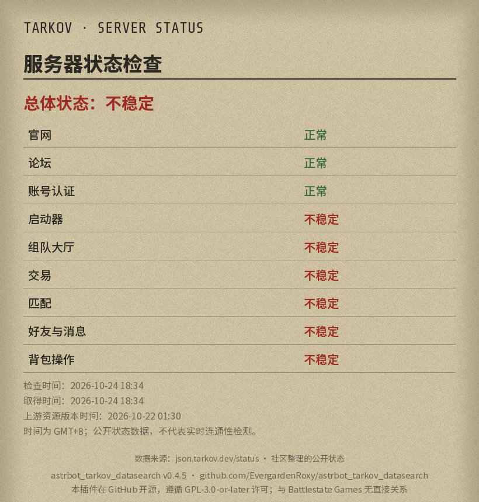
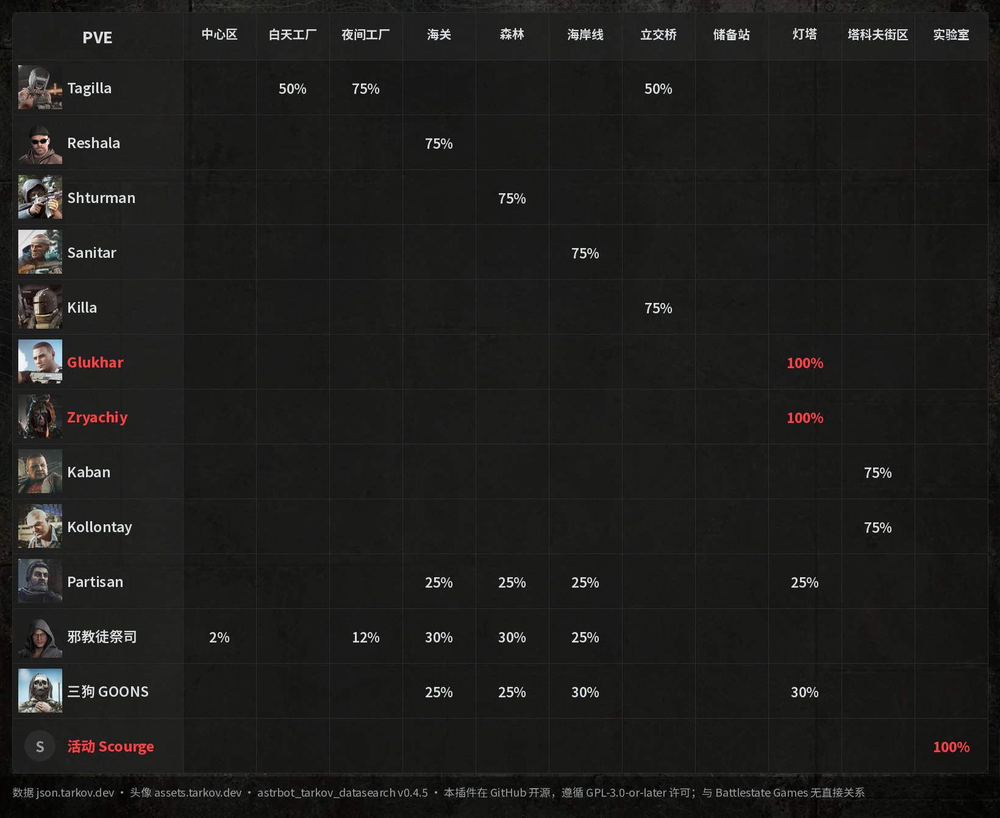
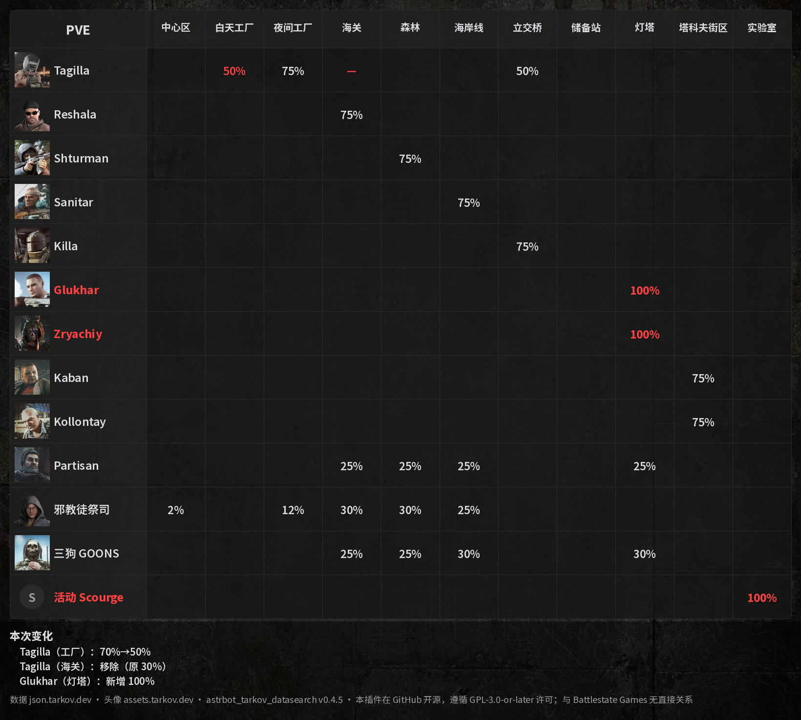

[← 返回 README](../README.md)

# 服务器状态与 Boss 刷率（可选功能）

这两项功能读取 [json.tarkov.dev](https://json.tarkov.dev) 的公开游戏数据（不是玩家档案），**默认关闭**，由管理员在配置页逐项开启。关闭时不下载对应数据，也不启动后台任务。回复目前**只有图片**，不受“输出方式”设置影响；文字和 Markdown 版本暂未提供。命令写法、权限、代理等通用设置见 [README](../README.md#通用设置)。

**命令**（`@机器人` 写法与 `/` 写法都能用，见“命令写法”）：

```text
@机器人 tarkov status                 （服务器状态；也可写 状态）
@机器人 tarkov boss                   （Boss 刷率全表，所有监控模式各一张）
@机器人 tarkov boss pve               （只看 PVE；也可写 pvp、赛季）
@机器人 tarkov boss 变化              （最近一次刷率变化，变化标红，图下方文字说明）
@机器人 tarkov boss 页 <快照编号> <页码>（长表续页，编号在图下方注明）
```

另外还有不加 `tarkov` 的短命令 `status`（状态）和 `boss`（刷率）；与其他插件冲突时，在配置里关闭“启用简短查询命令”，`tarkov status`、`tarkov boss` 仍可用。

**设置**（各项都在配置页，保存后重载生效）：

- **服务器状态图片查询**、**服务器状态变化图片播报**、**服务器状态轮询间隔**（2～30 分钟，默认 5）、**播报目标**、**允许向 QQ 官方机器人会话播报状态**。
- **Boss 刷率功能总开关**：关闭后整个 Boss 功能停用，不能查询，也不会轮询或推送。
- **Boss 刷率变化推送**：只控制后台轮询和推送，关闭后查询照常；开启还要求总开关已开、有监控模式和播报目标。**Boss 刷率轮询间隔**（2～30 分钟，默认 10）、**监控模式**（默认 pvp、pve、赛季）、**播报目标**、**允许向 QQ 官方会话播报 Boss 刷率**。
- **播报目标**要填完整的 AstrBot 会话标识（聊天中发送 `/sid` 查看），最多 50 个；留空就不轮询、不播报。播报不会发给所有会话，只发给你填写的目标。首次成功只建立基线，不推送；之后有变化才推送。插件只能“提交”消息，不能确认对方收到。
- **公共游戏数据缓存时间**（默认 5 分钟）：状态和 Boss 共用，只在过期后的查询里检查更新。
- **手动拉取/更新 Boss 头像**：执行一次后自动关闭，头像从 assets.tarkov.dev 取得，缓存 365 天；平时不会自动下载，没有头像时用占位图。
- **不当作活动 Boss 的怪物**（高级）：见下。

**Boss 图怎么看**：

- 行是 Boss，列是地图（中心区、白天工厂、夜间工厂、海关、森林、海岸线、立交桥、储备站、灯塔、塔科夫街区、实验室），格子里是刷率，左上角写模式。固定的行是 Tagilla、Reshala、Shturman、Sanitar、Killa、Glukhar、Zryachiy、Kaban、Kollontay、Partisan、邪教徒祭司和三狗 GOONS。同一格里有多个概率时分别显示，不相加。空白表示上游没有列出。
- 100% 的刷率用红色粗体，该 Boss 的名字也标红。
- **活动 Boss**：固定行之外，地图上列出的 Boss 记录，除 Raider、黑色军团、USEC、BEAR、游荡者、守军这几类普通怪物之外，都显示为“活动 <名字>”行，最多 3 行，超出时注明数量。上游新增了不想显示的普通怪物时，把它的 `normalizedName`（例如 `raider`）填进“不当作活动 Boss 的怪物”。
- **变化推送**：图和全表相同，变化的格子标红，图下方用文字列出“本次变化”，例如“三狗 GOONS（海岸线）：60%→80%”；活动 Boss 出现或结束也会列出。格子里只显示新值。
- 没有包含在表里的：破冰船、原中心区、实验室 Dark、迷宫、中心区教程、码头，以及普通 AI。







**关于示例图**：状态图和 Boss 表是 2026-10-24 用 `tools/build_public_preview.py` 取得的真实公开数据（PVE 模式）生成的，当时服务器状态里有几个组件显示“不稳定”，刷率也只是当天的数值。**变化图**的“上次”表是在当前真实数据上手工构造的 3 处差异（一个概率不同、一个记录不存在、一个已结束），用来展示“本次变化”的写法，不是真实发生过的变化。Boss 头像是 Battlestate Games 的游戏美术，只用来说明插件的显示效果，版权声明见 [THIRD_PARTY.md](../THIRD_PARTY.md)；插件包里不含这些头像。

**注意**：QQ 官方机器人的图片回复和主动推送（群权限、平台限制）还没有在真实环境里验证过；不同 AstrBot 版本和机器人权限对主动推送的支持不同，开启前请先在测试群里试一次。

## 数据存储（状态与 Boss）

数据位于 `data/plugin_data/astrbot_tarkov_datasearch/`：

- `public-data/resources.sqlite3`：公共游戏数据缓存（最多 32 项、约 128 MiB），首次查询时才生成，可以随时删除。
- `notifications.sqlite3`、`boss-notifications.sqlite3`：只在开启并配置了对应播报后生成，保存变化基线、待发事件、逐目标的发送状态和长表快照（事件保留 7 天）；删除后下次观察会重新静默建立基线。
- `boss-portraits/`：只在手动更新 Boss 头像后生成，是缩小的头像缓存（365 天），可以随时删除。
- 图片在内存中生成后直接发送，不写入磁盘。

## 相关

- 玩家档案查询见 [player-query.md](player-query.md)。
