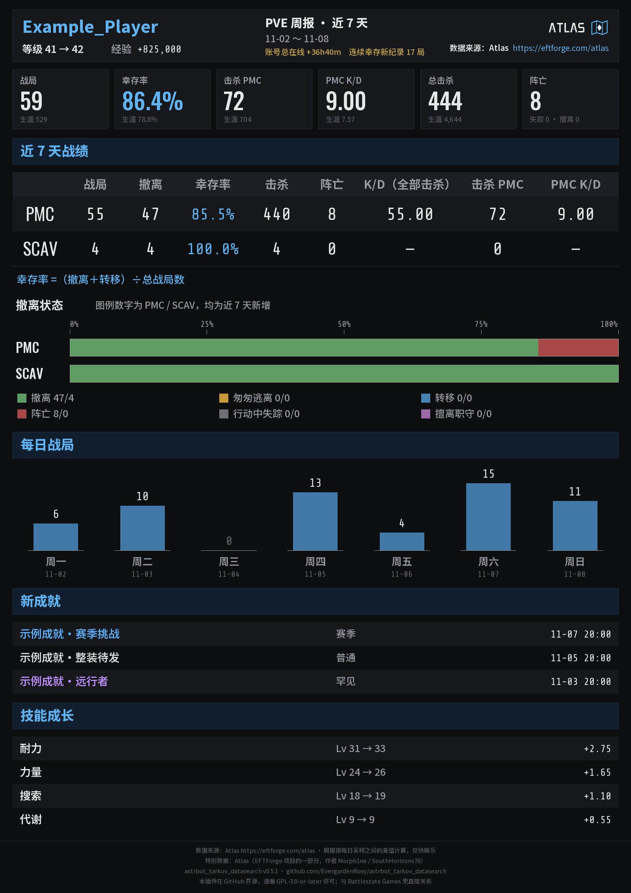
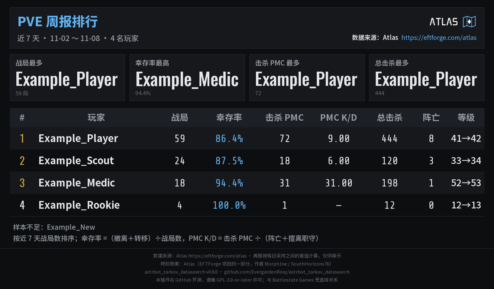

[← 返回 README](../README.md)

# 玩家周报（可选功能）

给管理员列出的玩家做“近 7 天”的战绩小结：每天凌晨自动采样一次，聊天里可以查个人周报和排行，也可以每周定时把排行发到指定的群。**默认关闭**，娱乐用途，数字是两次采样之间的差值，不是逐局记录。支持 PVP、PVE、赛季；竞技场已在规划里，尚未实现（见 [当前待办](../checklist.md#arena-weekly)）。

数据来自 **[Atlas](https://eftforge.com/atlas)**，所以需要“玩家数据来源”为 Atlas（默认值）。图片带 Atlas 标志和链接，图片后另附一行可点击的链接。

## 命令

```text
@机器人 tarkov 周报 [模式] [昵称或账号ID]    （也可写 tarkov weekly）
@机器人 tarkov 周报 [模式] 排行              （也可写 rank）
```

- 不写模式时用默认模式（默认 PVE）。QQ 官方机器人单词命令：`tweekly`，例如 `@机器人 tweekly pve 昵称`。
- 写了昵称或账号 ID：回复该玩家的个人周报，玩家必须在这个模式的名单里。
- 什么都不写：自己绑定的账号在名单里时回复自己的周报，否则回复这个模式的排行。
- 命令只读取已经采到的样本，**不会访问 Atlas**，也不占用每人每小时的查询次数。
- 只回复图片；出错或样本不够时回复一行文字。

## 图片





两张示例图由 `tools/build_weekly_preview.py` 用虚构数据生成。

- **个人周报**：近 7 天的战局、幸存率、击杀 PMC、PMC K/D、总击杀、阵亡（小字是生涯数字）；PMC／SCAV 表和撤离状态条；每日战局；新成就；技能成长。
- **排行**：名单内玩家按近 7 天战局数排序，最多列 20 名；上方是战局最多、幸存率最高（至少 5 局）、击杀 PMC 最多、总击杀最多。还没有足够样本的玩家列在表格下方。
- “近 7 天”从最近一次采样往前数 7 天。玩家刚加入名单不满 7 天时，图上会写“样本只覆盖 N 天”；期间发生删档、赛季重置或声望时会注明，重置后的数字从 0 计起。
- 每日战局按采样归日：凌晨采到的变化算作前一天。某天没有采样时显示“—”，那天的战局会并入之后的一天。
- 口径与玩家档案一致：幸存率 =（撤离＋转移）÷战局数；PMC K/D = 击杀 PMC ÷（阵亡＋擅离职守）；PVE 模式下的“击杀 PMC”是 AI PMC。“账号总在线”是整个账号的时长，不分模式。

## 采样规则

Atlas 是个人维护的服务。上游放宽使用限制后（2026-11-10），采样严格按下面的规则进行：

- 每天 **北京时间 03:00** 开始，**09:00** 前结束，只在这个时段访问 Atlas。
- 一次只查 **一名玩家**；下一次请求在 **120 秒加随机 20～60 秒** 之后。
- 只查名单里的玩家，每个模式每人每天一次；失败的当天再试一次，仍失败就等第二天。
- 机器人在这个时段没有运行（重启、掉线）就少一天样本，**不在白天补拉**。
- 名单里填的是昵称时，第一次需要先向 Atlas 搜索一次（单独占一次请求），之后记住对应的账号。
- 采样仍然经过插件的 Atlas 共用请求间隔和总额度，与用户查询共用。
- `busy` 等失败由采样任务按上述间隔重试；若上游要求等待更久，遵守更长的等待时间。排队和在途请求也受 09:00 截止限制。
- 同一模式下，账号 ID 和解析到该账号的昵称共用每天的采样进度与重试次数，排行只显示一次；查询个人周报仍可使用任一别名。
- 样本写入失败或关键统计缺失时不会标记为当天完成，按失败规则重试；已有相同数据时间的有效样本视为保存成功。
- 用户自己用命令查询名单内玩家时（`tarkov pve 昵称`），那次查询的结果也会顺带记为一个样本，不额外请求。

每个模式最多 40 名玩家：三个模式都填满是 120 次请求，按每次约 160 秒计，约 5.3 小时，正好在采样时段内。

## 设置

配置页“玩家周报”一组，保存后重载生效：

- **玩家周报功能**（默认关闭）：总开关。关闭时不采样、不播报，命令回复“尚未开启”。
- **PVP／PVE／PVP 赛季 周报玩家名单**：三个独立的列表，每行一名玩家，填账号 ID（推荐）或昵称。名单是全局的，由管理员维护；聊天里没有订阅命令。昵称有重名、改过名或超过 15 个字符时请填账号 ID。
- **周报样本保留天数**（14～180，默认 30）：超过的采样记录自动删除。从名单里去掉玩家不会立即删除记录，到期后自然清除。
- **每周自动播报排行**（默认关闭）、**播报日**（周一至周日，默认周一）、**播报时间**（时:分，北京时间，默认 10:00）：到时间向播报目标发送每个模式一张排行图；没有任何玩家有足够样本的模式不发。建议时间填在 09:00 之后。错过超过 6 小时（机器人当时没运行）不补发。
- **周报播报目标**：**必须填写**完整会话标识（聊天里发 `/sid` 查看），留空就不播报；与状态、Boss 推送不同，不会自动发给用过插件的群。仍受“限定聊天”限制。

播报每张图最多尝试 3 次；平台没有返回结果时不重发（可能已经送达）。插件只能“提交”消息，不能确认对方收到。

## 数据存储

`data/plugin_data/astrbot_tarkov_datasearch/weekly.sqlite3`：

- 名单昵称对应的账号 ID 和最新昵称；
- 每名玩家每天的采样进度；
- 样本：每次采样压缩后的数字（战局、撤离结果、击杀、等级、经验、在线时长、技能进度、近期成就），每条约 1～3 KB，不含完整档案；
- 每次播报对每个目标的提交结果（60 天后删除）。

不保存任何聊天用户的 ID。名单内玩家的战绩会出现在排行图里并发到播报目标，请只把愿意公开的玩家加入名单。采样取得的完整档案同样按“保存 Atlas 查询记录”的设置写入查询记录（见 [玩家数据查询](player-query.md)）。

### 升级与历史样本

升级时，已有昵称和账号 ID 的采样进度会自动合并：同一天的失败次数相加，任一条目已经完成则不会重复采样。样本和完成状态一起提交，重启后继续使用已保存的进度。

新样本在保存前校验 PMC、Scav 统计，合法的空计数或未出现的计数项仍按零处理；缺失、损坏的统计块不再写成零。旧样本保留并继续可读，不会根据计数下降猜测修复：旧版写入的零值可能是实际归零，也可能来自缺字段。如果保留了对应时间的 Atlas 原始查询记录，可以在离线核对原始记录后重建；没有原始记录的旧样本无法可靠还原，相关周报数字可能仍受影响，直到旧样本退出统计窗口。

## 相关

- [周报决策摘要](archive/development-history.md#weekly)：设计取舍与维护者的决定；[竞技场周报待办](../checklist.md#arena-weekly)。
- [玩家数据查询](player-query.md)、[Atlas 接入决策](archive/development-history.md#atlas-players)。

### 接口调用补充（2026-11-11）

夜间统计使用art=0，不请求角色和装备绘图；它与普通资料使用不同的缓存变体。Atlas访问暂停时暂缓采样，不消耗名单玩家的重试机会；管理员恢复后沿既有间隔和进度继续，错过夜间窗口不补跑。数字样本仍按现有保留规则保存，未因本次修改自动清理旧数据。
